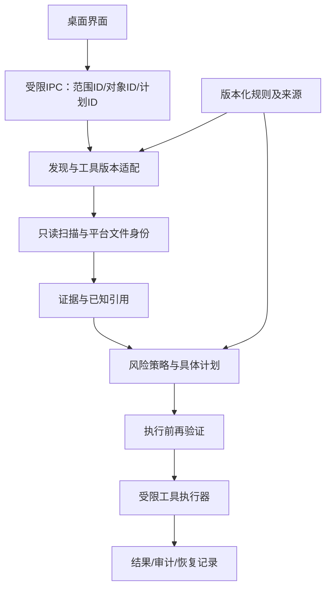

# Water 架构基线

状态：生产内核设计基线；B/C独立元数据/原型已验收，A契约补单单票通过、进行隔离集成；D夹具校验待补单修订，正式扫描器未实现。对应 [ADR-001](decisions/ADR-001-independent-core.md)。

第一轮的具体数据与Rust API见 [scan v1契约](../contracts/v1/README.md)；工程顺序、工具链及限定范围见 [ADR-002](decisions/ADR-002-wave1-contract-bootstrap.md)。契约材料已冻结不代表Rust实现已存在。

## 技术方向

暂选 Rust 核心 + Tauri 2 桌面壳 + TypeScript/React 界面。Rust 内核负责识别、证据、容量与计划；UI 负责展示与用户选择。优先建立可独立测试的核心，不先复制竞品界面或将其整个项目 fork 为 Water。

这不是最终版本锁定；下一阶段确认本机 Rust/MSVC、Windows WebView2、macOS 构建条件、依赖许可证与最低系统版本后冻结 lockfile。Tauri capabilities 可限制暴露给 WebView 的能力，但自定义 Rust 命令仍需自行校验，框架不代替对象级安全。[Tauri 安全边界](https://v2.tauri.app/security/)、[Capabilities](https://v2.tauri.app/security/capabilities/)、[分发](https://v2.tauri.app/distribute/)

当前立项辅助脚本使用 Node 内置模块，无运行时第三方依赖；不等于产品选择 Node 做文件系统核心。

[ADR-004](decisions/ADR-004-fixture-lab-before-scanner.md)追加独立D测试资产工具：Node只在本项目.local生成合成文件/链接和未来故障计划，供后续Rust扫描验收使用；没有遍历扫描/分类或清理能力。正式核心接口仍由总控在A验收后单独冻结。

## 分层与信任边界

核心模块拟分为 discovery、scan、identity、adapters、evidence、policy、planner、executor、journal、report；Windows 与 macOS 的文件身份、权限、链接、回收站和容量各有实现。

所有输入视为不可信：目录名、项目配置、工具输出、模型metadata和UI请求。扫描不执行项目脚本、不反序列化可执行pickle、不为探测自动安装/启动CLI或服务、不上传用户源码/提示词/模型。

## 数据契约

字节值跨 IPC 用十进制字符串，避免前端 number 超出安全整数范围；时间统一含时区。状态允许 unknown，不能靠默认 false 将未知变安全。

| 对象 | 必要内容 |
|---|---|
| ScanScope | scope_id、规范化根、平台、排除项、用户选择来源、扫描覆盖界限 |
| ToolInstance | 工具ID/版本、可信可执行路径、配置来源、实际根、backend/节点身份 |
| Finding | finding_id、scope_id、相对定位、工具归属、用途、证据、已知引用、风险、活跃状态、恢复条件、rule_version |
| SizeEstimate | logical_bytes、allocated_bytes可空、reclaimable区间可空、是否含共享块、计算方法、置信度 |
| ObjectIdentity | 卷/文件身份或工具对象ID、链接性质、元数据快照、取得方式和限制 |
| CleanupPlan | plan_id、选中finding、精确目标/受控动作、复核前提、不可逆说明、摘要、有效性策略 |
| OperationResult | 每项状态与原因、原生命令退出、身份/引用变化、恢复能力、宿主空间测量与干扰说明 |

IPC 不接受任意 `delete(path)` 或 `run(shell)`；UI 不能把展示用路径重新提交为删除目标。后端根据本地会话与具体对象生成计划，并在执行时验证真实目标。扫描会话白名单只是必要防线，不能替代文件身份和检查/使用竞态处理。

计划ID也不能单独证明用户同意。M2需明确WebView信任假设，将确认绑定到后端持有的具体对象集合和操作摘要；高风险操作采用后端生成的原生确认等适当机制。UI不能自行产生、扩大或重放已确认的执行权限，确认之后仍须复核身份与引用。

## 规则与适配器

适配器生命周期：`detect → resolve_config → enumerate → verify_shape → references → activity → estimate → plan → revalidate → execute → verify`。

规则必须包含工具版本/平台范围、路径来源、对象结构、资产排除、风险依据、官方文档、容量方法、动作范围与测试用例。纯名称、扩展名、mtime/atime 不足以授权删除。规则冲突时保护优先；“官方可清理”仍需考虑工具版本、选项、离线与私有访问条件。

原生命令如 npm verify、prune 会修改数据，不能在只读扫描中执行。执行器只调用受支持的原生机制；共享store不为了回收站语义直接搬空。

Docker context、Buildx builder driver 与所有 node endpoint 分别核对；本机清理流程对远程或不明目标保持只读。VM空间是父容器，内部对象只是拆解视图，不能叠加为额外磁盘空间。

## 运行与恢复

任务取消与错误按项传播，权限不足显示 partial/unreadable。默认不用管理员/root、不夺取权限、不删除锁、不强制停止用户任务。

普通清理流程的后端硬性保护：卷根、系统目录、HOME、项目源码根及包含受保护资产的祖先目录，不得整树移动或删除。用户显式选择扫描根、合法计划ID、规则命中或“大文件”都不能解除该保护。保护数据必须按对象保留；另行设计的资产归档不借用普通缓存清理权限。

计划执行前重新确认版本、scope、文件身份、引用和使用条件；变化使计划失效。设计平台句柄/身份机制减少TOCTOU，无法保证安全边界时不开该动作。不能只通过 canonicalize + startsWith 声称完全解决竞态。

操作journal需在变更前记录意图，变更后记录结果；崩溃后标不确定状态。普通隔离恢复和工具原生GC分开；重下载不是完整回滚。回收站/隔离仍占空间，恢复时不覆盖同名新文件。敏感路径在导出中脱敏，journal本地最小化留存。

M1 不实现 executor；M2 先以少量动作完成完整闭环，再扩规则。网络授权/支付/遥测与本地扫描解耦，首版不接模型API。
