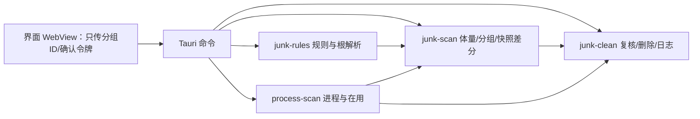

# ADR-018：转向全设备垃圾体检与应用内选择性清理

2026-10-26，总控（Claude）。依据用户同日对[计划重订草案](../REPLAN-20261026-AGENT-ERA-CHECKUP.md)五个问题的回复。本 ADR 取代 ROADMAP 中 M1“用户选目录、只读观察”的主线定义；A–AD 的已验收结论不变。

## 用户原话（2026-10-26）

1. 允许改变方向。
2. 可以，这是必须做的，我希望后续开发过程中可以利用本机实际产生的垃圾进行测试，这也是我作为开发者体验产品的一部分。
3. 应用内，我希望water是个集成的产品，用户后续只需要在软件内操作即可，有完整的GUI设计（整体UI设计需要你来做，外部worker负责执行，主题色我希望是淡蓝色的清爽感觉。）
4. 按照你建议来，我希望是要尽量把每个用户设备上的垃圾都能扫描出来（不止开发垃圾，包括应用安装装包之类的垃圾，浏览器缓存（非用户认证登录信息，避免清理之后需要重复登录）），进行评级，让用户可选择性清理。
5. 本身的垃圾在后续开发过程中，我希望通过使用water清理掉，这也算是一个重要的里程碑，而且清理过程你也可控。

## 决定

**产品。** Water 是一体化桌面应用：扫描设备上的垃圾，按规则分组、评级、说明原因，用户在应用内勾选后清理，看到前后对比。Windows 先行，macOS 后续。范围包括开发与 agent 工具垃圾，也包括通用系统与应用垃圾：临时目录、安装包残留、应用更新残留、崩溃转储、浏览器缓存等。

**评级。** 每个分组属于四级之一，界面文案固定：

| 级别 | 界面名 | 含义 | 默认勾选 |
|---|---|---|---|
| 1 | 推荐清理 | 规则明确的缓存与残留，清掉只会让下次变慢或重新下载 | 是 |
| 2 | 需要确认 | 可能对用户有用（安装包、会话临时目录、旧快照） | 否 |
| 3 | 仅供参考 | 需要改设置、重启或管理员权限才能处理，应用内不执行 | 不可勾选 |
| 4 | 受保护 | 会话记录、登录信息、项目仓库、未知数据库等，只显示占用 | 不可勾选 |

未被任何规则识别的目录归入“未识别”，只显示占用，不可勾选。

**浏览器。** 只清缓存类子目录（如 Chrome/Edge 的 `Cache`、`Code Cache`、`GPUCache`、着色器缓存）。Cookies、登录数据、Local Storage、IndexedDB、会话、历史、书签、扩展和偏好设置一律受保护，清理后不应需要重新登录。浏览器正在运行时，对应缓存标“关闭浏览器后可清”。

**应用内清理。** 原 M1“无删除接口”与 M2 合并为主线。界面只能提交分组 ID 与确认令牌，不能提交路径。确认令牌绑定后端生成的清理计划摘要。执行前逐项重新核对：仍在规则根内、仍匹配规则、年龄仍超过阈值、不是联接、未被进程占用、身份与扫描时一致。删除不进回收站，界面明确“不可恢复”。每次清理写操作日志，结束后展示实际释放量与前后可用空间。不提权；需要管理员的项只放“仅供参考”。

**真实数据。** 开发与测试期间，执行者与总控可以对本机做只读扫描：只读规则登记的位置、只读名字/大小/时间/属性、只读进程列表与命令行，不读任何文件内容。真实删除只经 Water 应用自身的清理流程发生，清理按钮由用户本人按下；总控负责准备计划、讲清内容、核对结果。执行者的删除测试只针对本工作树 `.local` 下的合成夹具。

**自清理里程碑。** Water 必须能识别自身开发留下的垃圾（Rust `target` 构建目录、测试浏览器 profile、各工作树私有 Cargo home 副本等），并由用户在 Water 里把它们清掉。验收证据保留，构建产物与 profile 可清。这是 M2 的放行条件之一。

**界面设计。** 总控负责整体 UI 设计（信息架构、页面、组件、文案、淡蓝主题色），设计稿在 `docs/design/water-ui-v1/`，执行者按设计稿实现。

**检查门。** 只读、规则数据与界面票用轻门：一份 SPEC、一份测试清单、一个检查入口，负控只砍承重逻辑。清理执行器与删除路径保留重门：有效负控、原字节恢复、总控独立复核和本机受控验收。不再为每波冻结全仓几百个文件。

## 结构

各核心 crate 只依赖 serde/serde_json（离线缓存已有），Windows FFI 沿用现有写法：裸 `extern "system"`，unsafe 只放在 `native_windows.rs`，其余模块 `forbid(unsafe_code)`。桌面应用为新的 `apps/water`，安全设置沿用 AC 已验收的导航校验、私有 WebView 目录、拒绝新窗口/下载/权限请求，另外为分组 ID 级 IPC 开放 JavaScript。

## 复用与降级

复用：A 的未知保护与字节字符串约定、R/N 的不跟联接与句柄身份做法、Q 的脱敏导出思路、AC 的桌面安全设置、AB/AD 的同意绑定与页面经验、B 的“数据 + 校验器”写法。AA/AB/AD 的“选项目目录 + 读 package.json 结构”保留为次要功能，暂不追加投入。我此前草拟、未出票的“把 AB 的 Node 校验搬到 Rust”接线方案作废，新主线由可信宿主进程内直接调用各 crate。

## 仍不做

不做注册表清理、系统加速、内存优化；不靠 LLM 判断能否删除；不自动删除；不清理凭证与登录态；不碰项目仓库与 `.git`；不提权；不承诺可恢复。macOS 在 Windows 版主线跑通后再开。
